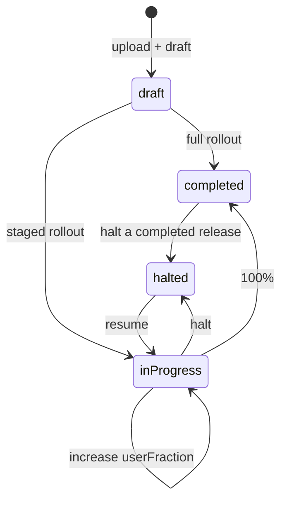

# 01 — Google Play Publishing API capabilities and limits

This document answers "what exactly can be automated" and records the limits that shape the
architecture (see [02-architecture.md](02-architecture.md)).

## 1. API and authentication

- Service: `androidpublisher.googleapis.com`, version `v3`.
- The only scope we need: `https://www.googleapis.com/auth/androidpublisher`.
- Authentication is OAuth 2.0. CI uses a service account (JSON key or Workload Identity
  Federation) added to Play Console as a user with release permissions. Linking a GCP project
  to the developer account is no longer required
  ([Getting Started](https://developers.google.com/android-publisher/getting_started)).
- Go client: `google.golang.org/api/androidpublisher/v3` (module `google.golang.org/api`,
  `v0.311.0` at design time). Google lists only Java and Python in
  [Client Libraries](https://developers.google.com/android-publisher/libraries), but the Go
  client is generated from the same discovery document and covers every method we use. This
  is a maintenance risk, not a blocker (see [ADR-0001](adr/0001-androidpublisher-go-client.md)).

## 2. The transactional edits model

Every change is prepared in an "edit" and applied with a single commit
([Edits](https://developers.google.com/android-publisher/edits)):

| Step | Method | Meaning |
| --- | --- | --- |
| 1 | `edits.insert` | Create an edit — a snapshot of the app's current state |
| 2 | `edits.bundles.upload` | Upload the AAB into the edit's storage, get the `versionCode` |
| 3 | `edits.tracks.update` | Declare the release on a track (declarative) |
| 4 | `edits.commit` | Apply everything and submit for review |

Properties that matter for the design:

- **Isolation.** Nothing is visible to users before `commit`; a failed edit can be deleted
  (`edits.delete`) or simply expires (`expiryTimeSeconds`).
- **One active edit per user per app.** A new `edits.insert` invalidates the previous edit of
  the same user.
- **Any change in Play Console invalidates all active edits** of the app, including those of
  other users.
- **Committing the first of several parallel edits invalidates the others.**
- **Changes are not applied instantly** — "several hours", as with the console. A successful
  `commit` does not mean users already have the build.
- The app must already exist and have at least one uploaded build. The API cannot create an
  app, change its publication status, or accept legal declarations — only Play Console can.

## 3. Tracks and releases

A track is a delivery channel. Names seen in practice:

| Track | API name | Notes |
| --- | --- | --- |
| Internal testing | `internal` | Fastest verification channel |
| Closed testing | `alpha` and custom names | Created manually in the console |
| Open testing | `beta` | Public test |
| Production | `production` | All users |
| Form factors | `wear:production`, `automotive:beta`, `tv:production`, `android_xr:production`, `google_play_games_pc:production` | Prefix + track name |

> **Documentation discrepancy.** The
> [APKs and Tracks](https://developers.google.com/android-publisher/tracks) page calls the
> internal track `qa`, while in practice the name is `internal` (it appears in fastlane and
> Gradle Play Publisher configurations). The tool therefore does not hard-code the list: it
> reads tracks through the API and accepts any name; `internal` is only the default.

A release (`Release`) on a track has these fields:

- `versionCodes[]` — builds included in the release;
- `status` — `draft` | `inProgress` | `halted` | `completed`;
- `userFraction` — user share for `inProgress` (0 < f < 1);
- `releaseNotes[]` — `{language, text}`, at most 500 characters per locale;
- `name` — human-readable release name;
- `inAppUpdatePriority` — in-app update priority `0..5`; it cannot change once the release is
  rolled out;
- `countryTargeting` — `{countries[], includeRestOfWorld}`; Play accepts it only for an
  `inProgress` release on the `production` track.

`edits.tracks.get` reads the same resource inside an edit. The tool uses it in `rollout` and
`promote`, which modify or copy an existing release: with a declarative `tracks.update` the
whole release must be sent back, so the fields above are preserved instead of reset.

Status semantics ([APKs and Tracks](https://developers.google.com/android-publisher/tracks)):

Important details:

- `tracks.update` is **declarative**: it replaces the track resource rather than appending a
  release. The tool builds the desired state explicitly; which list to send (only the new
  release, or the new one plus history) is verified by an integration test against a real app.
- Halting a `completed` release is only possible when a previous `completed` release exists to
  become the fallback. This is a Play limit, not a client one.
- A draft lets you upload an AAB and prepare a release, then publish it later from the console.
- A halted release keeps its `userFraction`; resuming it means sending `inProgress` with the
  same or a larger fraction, which is exactly what `rollout --fraction` does.

### Store metadata in the same edit

Besides tracks, an edit accepts the store presence of the app
([Edits](https://developers.google.com/android-publisher/edits)):

| Resource | Method | Content |
| --- | --- | --- |
| `edits.listings` | `update`, `patch`, `get`, `list`, `delete` | `title`, `shortDescription`, `fullDescription`, `video` for one BCP-47 language |
| `edits.images` | `upload`, `delete`, `deleteall`, `list` | `appIcon`, `featureGraphic`, `promoGraphic`, `tvBanner` and the screenshot types, per language |
| `edits.testers` | `update`, `patch`, `get` | `googleGroups[]` for a track |

Limits that shape validation: title 30, short description 80 and full description 4000
characters; icon 512x512; feature graphic 1024x500; images must be PNG or JPEG. Because an
edit is a snapshot, listings, images, testers and the AAB are committed together, so the store
metadata of a release can be versioned in the repository next to the changelogs.

## 4. Review, submission and managed publishing

`edits.commit` by default **cancels changes that are in review and submits all accumulated
changes again**. The behavior is controlled by two parameters:

| Parameter | Value | When to use |
| --- | --- | --- |
| `changesInReviewBehavior` | `CANCEL_IN_REVIEW_AND_SUBMIT` (default) | Normal deploy when cancelling the previous review is acceptable |
| | `ERROR_IF_IN_REVIEW` | **The tool's safe default**: if something is already in review, return an error instead of breaking the review |
| `changesNotSentForReview` | `false` (default) | Normal deploy |
| | `true` | Save changes but submit them manually from the console |

A known rejection case: Play may answer that changes cannot be sent for review automatically
and require `changesNotSentForReview=true` (for example, when the app has unfinished
declarations). The tool then retries the commit with `true`, reports "manual action required"
and exits with a dedicated code.

**Managed publishing.** If the account has managed publishing enabled, `commit` submits
changes for review but does not publish them: they land in "Changes ready to publish" and wait
for manual confirmation. The API cannot complete that publication. For our scenario this is
not a problem: **internal test tracks are not covered by managed publishing** — changes on
`internal` usually become available immediately, without review. Review is still required in
two cases: the app's first rollout happens on `internal`, or the previous submission was
rejected. For `closed`/`open`/`production`, managed publishing holds rollouts, and the API
cannot finish the publication — keep that in mind if the project moves beyond `internal`.

**Review time** is not controlled by the API and is not predictable; the tool must not "wait
for publication" inside a CI step.

## 5. AAB upload

`edits.bundles.upload` supports `uploadType=media|multipart|resumable`
([Uploading Files](https://developers.google.com/android-publisher/upload)):

- AABs use resumable uploads; chunks are multiples of 256 KiB;
- the media is declared as `application/octet-stream`; an AAB is a ZIP archive, so letting the
  client sniff the type sends `application/zip`, which Play rejects with HTTP 400;
- an upload session has a limited lifetime; on `404`/`410` the upload must be restarted;
- Google recommends increasing the HTTP timeout for `bundles.upload` (about 2 minutes);
- the response contains `versionCode`, `sha1`, `sha256` — log them and return them in JSON.

The Go client exposes this as `Edits.Bundles.Upload(...).Media(...)` with
`googleapi.ChunkSize(...)` and `googleapi.ChunkRetryDeadline(...)`; progress goes through
`ProgressUpdater`. Files smaller than one chunk are sent as a single multipart request.

Size limits (Play Console Help, 2026): base module — 500 MB download, individual feature
modules — 500 MB, asset packs — 1.5 GB, cumulative — 4 GB; above 200 MB users see a
large-app warning. Play enforces the limits, not the client.

## 6. Signing

- Play accepts only a **signed** AAB. The tool does not sign or cryptographically verify
  artifacts — Gradle (`signingConfig`) or `jarsigner` does that during the build.
- For apps with Play App Signing, the uploaded artifact is signed with the **upload key**, not
  the app signing key. Google re-builds and signs APKs for devices.
- Signature errors come back from Play as validation errors (400) and cannot be fixed by a
  retry — the bundle must be rebuilt.

## 7. Quotas, concurrency, limits

- [Quotas](https://developers.google.com/android-publisher/quotas): 3000 requests per minute
  per category; publishing, monetization and review replies share one bucket. For a single
  publication this is irrelevant.
- There is a **daily edit creation quota**: when exhausted, the API returns
  `403 Daily edit creation quota exceeded.` Google does not document the exact value. The
  practical rule: one run = one edit, no "create-delete" loops, no speculative retries of
  edit creation.
- One active edit per user per app; parallel CI runs must be excluded (concurrency group /
  lock).
- [Concurrency considerations](https://developers.google.com/android-publisher/concurrency-considerations):
  console and API must not work concurrently; a commit submits everything, including changes
  made in the console.

## 8. Legal constraints

[API Usage Instructions](https://developers.google.com/android-publisher/api_usage) explicitly
forbid:

- using the API to offer third parties a service or tool that creates, uploads, publishes or
  updates apps on Google Play;
- sharing service account access or private keys with third parties.

Consequence: the tool is valid as an **internal** tool of the account owner (own CI, own
apps). Using it as a SaaS/product for other accounts violates the terms and risks account
suspension.

The same page recommends not publishing alpha/beta more often than once a day.

## 9. Alternatives

| Option | Pros | Cons | Verdict |
| --- | --- | --- | --- |
| Go client `google.golang.org/api/androidpublisher/v3` + Edits API | Single static binary, full control, testable, native to Go projects | Generated client (v0), some new fields arrive late | **Chosen** |
| Hand-written REST + `golang.org/x/oauth2` | No generator dependency, immediate access to new fields | More code: resumable upload, pagination, error parsing, OAuth | Fallback if the client lags |
| fastlane `supply` | Mature, many cases covered | Ruby runtime in CI, overhead, another config layer | Not for a Go project |
| Gradle Play Publisher | Deep Gradle integration | JVM/Gradle, tied to the build, not a standalone CLI | Not suitable |
| Unofficial Go wrappers | Less code | Not maintained by Google, abandoned-project risk | No |

## 10. Risks and mitigations

| Risk | Impact | Mitigation |
| --- | --- | --- |
| Managed publishing enabled (outside `internal`) | "Deploy succeeded" but testers/users got nothing | Check the mode before moving to other tracks; irrelevant for `internal` |
| Concurrent console change | Edit invalidated, publish fails | Fail fast with a clear message, rerun |
| `CANCEL_IN_REVIEW_AND_SUBMIT` default | Cancels someone else's review | `ERROR_IF_IN_REVIEW` by default |
| Reused version code | Play rejects the release | Preflight check + dedicated exit code |
| Daily edit quota | Publishing unavailable until the next day | One edit per run, no loops |
| API/client changes | Build breaks after an update | Pin `google.golang.org/api`, contract tests |

## 11. Conclusion

There are no technical blockers. "Take a signed AAB and publish it to a selected track" is
covered by the Publishing API; the limits concern app creation, the first publication, managed
publishing and legal declarations — all of which remain manual Play Console steps.
