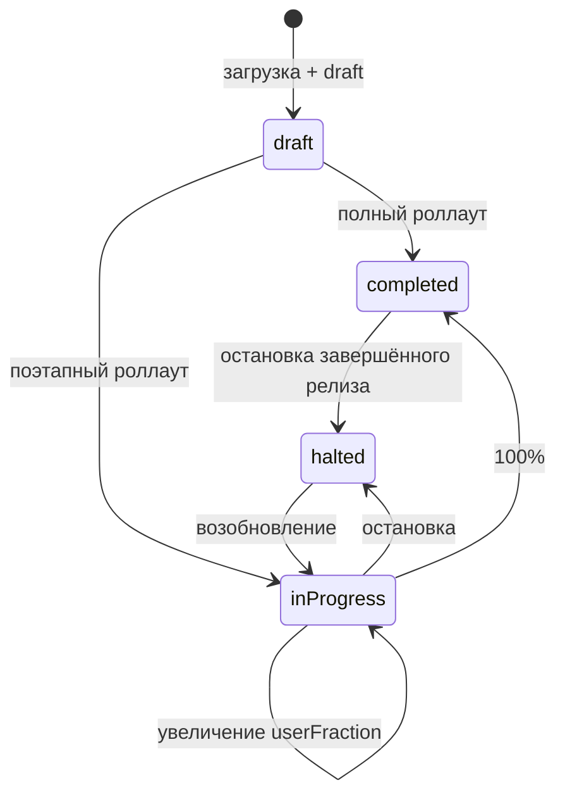

# 01 — Возможности и ограничения Google Play Publishing API

Документ отвечает на вопрос «что именно можно автоматизировать» и фиксирует ограничения, которые
определяют архитектуру (см. [02-architecture.md](02-architecture.md)).

## 1. API и авторизация

- Сервис: `androidpublisher.googleapis.com`, версия `v3`.
- Единственный нужный scope: `https://www.googleapis.com/auth/androidpublisher`.
- Аутентификация — OAuth 2.0. Для CI используется service account с JSON-ключом, добавленный в Play Console
  как пользователь с правами на релизы. Ссылка GCP-проекта с аккаунтом разработчика больше не требуется
  ([Getting Started](https://developers.google.com/android-publisher/getting_started)).
- Go-клиент: `google.golang.org/api/androidpublisher/v3` (модуль `google.golang.org/api`, на момент проектирования
  `v0.311.0`). Google в разделе [Client Libraries](https://developers.google.com/android-publisher/libraries)
  перечисляет только Java и Python, но Go-клиент генерируется из того же discovery-документа и покрывает все
  используемые методы. Это риск сопровождения, а не блокер (см. [ADR-0001](adr/0001-androidpublisher-go-client.md)).

## 2. Транзакционная модель edits

Любое изменение приложения готовится в «правке» и применяется одним коммитом
([Edits](https://developers.google.com/android-publisher/edits)):

| Шаг | Метод | Смысл |
| --- | --- | --- |
| 1 | `edits.insert` | Создать edit — снимок текущего состояния приложения |
| 2 | `edits.bundles.upload` | Загрузить AAB в хранилище edit, получить `versionCode` |
| 3 | `edits.tracks.update` | Объявить релиз в треке (декларативно) |
| 4 | `edits.commit` | Применить всё и отправить на ревью |

Свойства модели, важные для проектирования:

- **Изоляция.** До `commit` изменения не видны пользователям; неудачный edit можно удалить (`edits.delete`)
  или «забыть» — он истечёт сам (`expiryTimeSeconds`).
- **Один активный edit на пользователя и приложение.** Новый `edits.insert` инвалидирует предыдущий edit
  этого же пользователя.
- **Любое изменение в Play Console инвалидирует все активные edits** приложения, включая чужие.
- **Коммит первого из параллельных edits инвалидирует остальные.**
- **Изменения применяются не мгновенно** — «несколько часов», как и при работе через консоль. Это надо
  учитывать в релизном процессе: успешный `commit` ≠ «уже у пользователей».
- Приложение должно уже существовать и иметь хотя бы одну загруженную сборку. Нельзя создать приложение,
  изменить статус публикации или заполнить юридические согласия через API — только через Play Console.

## 3. Треки и релизы

Трек — это канал доставки. Имена, которые встречаются на практике:

| Трек | Имя в API | Комментарий |
| --- | --- | --- |
| Internal testing | `internal` | Самый быстрый канал проверки |
| Closed testing | `alpha` и кастомные имена | Создаются вручную в консоли |
| Open testing | `beta` | Публичный тест |
| Production | `production` | Все пользователи |
| Форм-факторы | `wear:production`, `automotive:beta`, `tv:production`, `android_xr:production`, `google_play_games_pc:production` | Префикс + имя трека |

> **Расхождение в документации.** Страница [APKs and Tracks](https://developers.google.com/android-publisher/tracks)
> называет внутренний трек `qa`, тогда как на практике используется имя `internal` (оно встречается в
> конфигурациях fastlane и Gradle Play Publisher). Поэтому инструмент не хардкодит список, а получает треки
> через API и принимает любое имя; `internal` — лишь значение по умолчанию.

Релиз (`Release`) в треке описывается полями:

- `versionCodes[]` — какие сборки входят в релиз;
- `status` — `draft` | `inProgress` | `halted` | `completed`;
- `userFraction` — доля пользователей для `inProgress` (0 < f < 1);
- `releaseNotes[]` — `{language, text}`, не длиннее 500 символов на локаль;
- `name` — человекочитаемое имя релиза.

Семантика статусов ([APKs and Tracks](https://developers.google.com/android-publisher/tracks)):

Важные нюансы:

- `tracks.update` — **декларативный** метод: он заменяет ресурс трека, а не «добавляет релиз». Инструмент
  формирует желаемое состояние явно; какой именно список отправлять (только новый релиз или новый + история) —
  проверяется интеграционным тестом на реальном приложении.
- `halted` для `completed`-релиза возможен только при наличии предыдущего `completed`-релиза, который станет
  фолбэком. Это ограничение Play, а не API-клиента.
- Черновик (`draft`) позволяет загрузить AAB и подготовить релиз, а опубликовать его позже из консоли.

## 4. Ревью, отправка и managed publishing

`edits.commit` по умолчанию **отменяет изменения, находящиеся на ревью, и отправляет все накопленные изменения
заново**. Поведение управляется параметрами:

| Параметр | Значение | Когда использовать |
| --- | --- | --- |
| `changesInReviewBehavior` | `CANCEL_IN_REVIEW_AND_SUBMIT` (по умолчанию) | Обычный деплой, когда предыдущий релиз не жалко отменить |
| | `ERROR_IF_IN_REVIEW` | **Безопасный дефолт инструмента**: если что-то уже на ревью — вернуть ошибку и не ломать проверку |
| `changesNotSentForReview` | `false` (по умолчанию) | Обычный деплой |
| | `true` | Сохранить изменения, но отправить на ревью вручную из консоли |

Известный сценарий отказа: Play может ответить, что изменения нельзя отправить на ревью автоматически, и
потребовать `changesNotSentForReview=true` (например, для приложений с незаполненными декларациями). Тогда
инструмент повторяет коммит с `true`, сообщает «требуется ручное действие» и завершается отдельным кодом.

**Managed publishing.** Настройка Play Console, которая разделяет «изменения одобрены» и «изменения
опубликованы»: при включённом режиме одобренные изменения ждут в «Changes ready to publish» до ручного
«Publish changes» ([Play Console Help](https://support.google.com/googleplay/android-developer/answer/9859654)).

Для нашего сценария это не проблема: **внутренние треки под managed publishing не попадают** — изменения в
`internal` обычно становятся доступны сразу, без ревью. Ревью всё же потребуется в двух случаях: если это
первый роллаут приложения и он делается в `internal`, либо если предыдущая отправка была отклонена. Для
`closed`/`open`/`production` managed publishing задерживает роллауты, и API не умеет завершать публикацию —
это придётся учитывать, если проект выйдет за пределы `internal`.

**Время ревью** не управляется API и не предсказуемо; инструмент не должен «ждать публикации» в рамках CI-шага.

## 5. Загрузка AAB

Метод `edits.bundles.upload` поддерживает `uploadType=media|multipart|resumable`
([Uploading Files](https://developers.google.com/android-publisher/upload)):

- для AAB используется resumable-загрузка; чанки кратны 256 KiB;
- сессия загрузки живёт ограниченно; при `404`/`410` загрузку начинают заново;
- Google рекомендует увеличить HTTP-таймаут для `bundles.upload` (порядка 2 минут);
- ответ содержит `versionCode`, `sha1`, `sha256` — их нужно логировать и возвращать в JSON.

В Go-клиенте это `Edits.Bundles.Upload(...).ResumableMedia(ctx, reader, size, "application/octet-stream")`
с опциями `googleapi.ChunkSize(...)` и `googleapi.ChunkRetryDeadline(...)`; прогресс — через `ProgressUpdater`.

Ограничения размера (Play Console Help, 2026): базовый модуль — 500 MB загрузки, отдельные feature-модули —
500 MB, asset packs — 1.5 GB, суммарно — 4 GB; при размере > 200 MB пользователь видит предупреждение.
Лимиты проверяются Play, а не клиентом.

## 6. Подпись

- Play принимает только **подписанный** AAB. Инструмент подпись не выполняет и не проверяет криптографически —
  это делает Gradle (`signingConfig`) или `jarsigner` при сборке через bundletool.
- Для приложений с Play App Signing загружаемый артефакт подписывается **upload key**, а не ключом подписи
  приложения. С момента передачи ключа Google пересобирает и подписывает APK для устройств.
- Ошибки подписи приходят от Play как ошибки валидации (400) и не лечатся ретраем — нужна пересборка.

## 7. Квоты, конкурентность, лимиты

- [Quotas](https://developers.google.com/android-publisher/quotas): 3000 запросов в минуту на категорию;
  публикация, монетизация и ответы на отзывы делят один bucket. Для одной публикации это несущественно.
- Существует **суточная квота на создание edits**: при её исчерпании приходит `403 Daily edit creation quota
  exceeded.` Точное значение Google не документирует. Практический вывод: один запуск = один edit, без циклов
  «создал-удалил» и без ретраев создания edit «на всякий случай».
- Один активный edit на пользователя на приложение; параллельные запуски в CI должны быть исключены
  (concurrency group / lock).
- [Concurrency considerations](https://developers.google.com/android-publisher/concurrency-considerations):
  несовместимая работа консоли и API, коммит отправляет на ревью всё, включая изменения из консоли.

## 8. Правовые ограничения

[API Usage Instructions](https://developers.google.com/android-publisher/api_usage) прямо запрещает:

- использовать API, чтобы предлагать третьим лицам сервис/инструмент, который создаёт, загружает, публикует
  или обновляет приложения в Google Play;
- передавать третьим лицам доступ к service account и его приватным ключам.

Следствие: инструмент допустим как **внутренний** инструмент владельца аккаунта (свой CI, свои приложения).
Использование его как SaaS/продукта для чужих аккаунтов — нарушение ToS и риск блокировки аккаунта.

Там же — рекомендация не публиковать alpha/beta чаще раза в день.

## 9. Альтернативы

| Вариант | Плюсы | Минусы | Вердикт |
| --- | --- | --- | --- |
| Go-клиент `google.golang.org/api/androidpublisher/v3` + Edits API | Один статический бинарник, полный контроль, тестируемость, нативный для Go-проектов | Клиент генерируемый (v0), часть новых полей появляется с задержкой | **Выбран** |
| Самописный REST + `golang.org/x/oauth2` | Нет зависимости от генератора, доступ к любым новым полям сразу | Больше кода: resumable upload, пагинация, разбор ошибок, OAuth | Резерв, если клиент отстанет |
| fastlane `supply` | Зрелый, много кейсов | Ruby-рантайм в CI, оверхед, свой слой конфигурации | Не для Go-проекта |
| Gradle Play Publisher | Глубокая интеграция с Gradle | JVM/Gradle, привязка к сборке, не отдельный CLI | Не подходит |
| Неофициальные Go-обёртки | Меньше кода | Не поддерживаются Google, риск заброшенности | Нет |

## 10. Риски и их снятие

| Риск | Влияние | Снятие |
| --- | --- | --- |
| Managed publishing включён (за пределами `internal`) | «Деплой прошёл», тестеры/пользователи ничего не получили | Проверить режим до выхода на другие треки; для `internal` не актуально |
| Конкурентное изменение в консоли | Edit инвалидирован, публикация падает | Быстрый fail с понятным сообщением, повторный запуск |
| `CANCEL_IN_REVIEW_AND_SUBMIT` по умолчанию | Отмена чужого ревью | `ERROR_IF_IN_REVIEW` по умолчанию |
| Повторный versionCode | Play отклоняет релиз | Preflight-проверка + отдельный код выхода |
| Суточная квота edits | Публикация недоступна до следующих суток | Один edit на запуск, отсутствие циклов |
| Изменения в API/клиенте | Сборка ломается после обновления зависимости | Пин версии `google.golang.org/api`, контрактные тесты |

## 11. Вывод

Технических блокеров нет. Сценарий «взять подписанный AAB и опубликовать его в выбранный трек» реализуется
штатными методами Publishing API; ограничения касаются создания приложения, первой публикации, managed
publishing и юридических деклараций — всё это остаётся ручными шагами Play Console.
