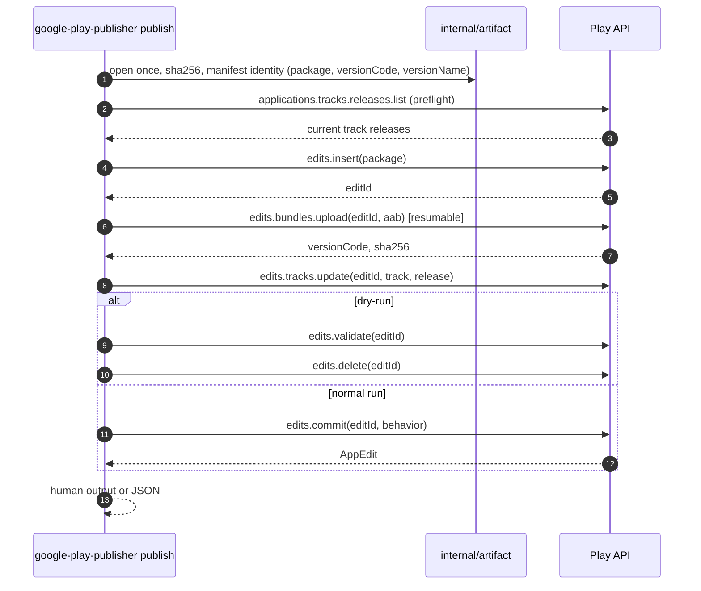

# 02 — Architecture

## 1. Principles

1. **Stateless.** No local database, cache or "unfinished transactions". State lives in Play;
   locally we only have the artifact and the run parameters.
2. **One run — one edit.** This minimizes daily quota usage and the conflict surface.
3. **Fail fast.** Authentication, permission, missing-app and state-conflict errors are not
   retried.
4. **Known reversibility.** Everything can be deleted before `commit`; afterwards only a new
   release or a halt is possible.
5. **Safe defaults.** Do not cancel someone else's review; do not publish to production
   without an explicit flag; do not drop track history.
6. **Machine-readable.** Every result has an exit code and a JSON representation for CI.

## 2. Package layout

```
cmd/google-play-publisher/   main: build App, call cli.Execute, os.Exit(code)
internal/cli/                cobra: root + commands (thin layer, one file per command)
  root.go                    PersistentFlags, groups, Execute
  publish.go                 flags → app.Publish
  doctor.go                  flags → app.Doctor
  status.go                  flags → app.Status
internal/app/                use cases without cobra and without androidpublisher
internal/play/               thin wrapper over androidpublisher: interface + client + error mapping
internal/artifact/           artifact inspection: ZIP signature, output-metadata.json, sha256
internal/release/            domain: Plan, status/rollout/notes validation, track names
internal/retry/              (reserved) backoff policy and error classification
internal/logging/            slog, debug transport, secret redaction
internal/exitcode/           typed errors → process exit codes
internal/version/            version, commit, build date
```

Why this shape:

- `cli` does not know about `androidpublisher` — only use cases from `app` and the `play.API`
  interface;
- `app` does not know about `cobra` — it orchestrates publish steps and is easy to test;
- `release` has no HTTP — pure validation, easily covered by table tests;
- `play` is the only place with Google client types, so client upgrades do not leak across the
  codebase.

The stack and cobra conventions are in [06-stack.md](06-stack.md); the decision is recorded in
[ADR-0003](adr/0003-cobra-command-layout.md).

## 3. Boundaries and interface

```go
// internal/play
type API interface {
    CreateEdit(ctx context.Context, pkg string) (editID string, err error)
    UploadBundle(ctx context.Context, pkg, editID string, r io.Reader, size int64) (BundleInfo, error)
    UpdateTrack(ctx context.Context, pkg, editID, track string, rel Release) error
    ValidateEdit(ctx context.Context, pkg, editID string) error
    CommitEdit(ctx context.Context, pkg, editID string, opts CommitOptions) error
    DeleteEdit(ctx context.Context, pkg, editID string) error
    TrackReleases(ctx context.Context, pkg, track string) ([]ReleaseSummary, error) // read-only
}
```

`CommitOptions{ChangesNotSentForReview bool, InReviewBehavior string}`.
`BundleInfo{VersionCode int64, SHA256, SHA1 string}` — exactly what logs and JSON need.

The implementation is `play.Client` holding an `*androidpublisher.Service`: the service is
created with `option.WithHTTPClient` (a context-aware cloud auth client built from ADC or
`--credentials`, so token acquisition and refresh use the operation context) and
`option.WithEndpoint` for tests; the User-Agent is set in the transport, and the timeout is
defined by the operation context.

## 4. The `publish` flow



### Preflight (before creating an edit)

- the file exists, is readable, is non-empty, is a ZIP and contains `BundleConfig.pb`
  (the marker of an AAB, not an APK);
- the base manifest `base/manifest/AndroidManifest.xml` is a valid protobuf XML document and
  contains `package`, a positive `android:versionCode` and an optional `android:versionName`;
  malformed values, resource references and a non-zero `android:versionCodeMajor` are local
  errors;
- the package is valid (dot-separated segments) and comes from the AAB; `--package` is an
  optional assertion;
- when `--metadata output-metadata.json` is passed, its `applicationId` and `versionCode`
  must equal the AAB values (legacy cross-check). AGP does not produce this file for
  `bundleRelease`, so AAB pipelines do not need it;
- the track exists in the track list (custom closed-track creation is outside the MVP);
- if the AAB `versionCode` is already present on the target track, apply `--if-exists`
  (`fail` by default); `skip` therefore works without a metadata sidecar;
- status and fraction are consistent: `inProgress` requires `0 < rollout < 1`, `completed`
  takes no fraction.

Local validation runs before the API client is constructed: an invalid package, track,
status, rollout, notes, AAB or metadata pair fails with code 2 without authentication and
without a network call. Retries of the remaining safely repeatable calls are bounded (see
[05-errors.md](05-errors.md#3-retry-policy)).

`app.Prepare` owns all local validation, including the policy options (`--if-exists`,
`--on-in-review`, `--dry-run` together with `--changes-not-sent-for-review`), resolving
package and version code from the AAB manifest, and reading `--changelog-dir` notes after the
version code is known. It opens the AAB once and returns an opaque prepared operation that
owns the handle; `PublishPrepared` accepts only that value, uploads from the same handle and
closes it on every path. A direct app caller cannot apply options that were not validated.
The CLI only parses flags, calls `Prepare` and formats the result.

Preflight is deliberately cheap and does not create an edit: the daily edit quota is spent
only after everything else has been checked.

### Upload

- `Media` with `googleapi.ContentType("application/octet-stream")`,
  `googleapi.ChunkSize(8 MiB)` and `googleapi.ChunkRetryDeadline(30 s)`: files smaller than
  one chunk are sent as a multipart request, larger ones as resumable chunks;
- the media type is explicit: an AAB is a ZIP archive, so content sniffing would declare
  `application/zip` and Play rejects the upload with `Media type 'application/zip' is not
  supported. (HTTP 400)`;
- progress goes through `ProgressUpdater`, `INFO` every 5% (more detail in debug), so CI does
  not look stuck;
- the upload reads from the `*os.File` opened by `Prepare`, so replacing the path during the
  run cannot change the uploaded bytes;
- after the response, compare the returned `sha256` with the inspected value and log
  `versionCode`; a mismatch means the transport or server changed the payload, so the edit is
  deleted before `tracks.update` and the command fails.

### Track update

The MVP sends **one release** in `tracks.update` (as in the Google example). This is a
declarative replacement of the resource: the tool does not append to history. If an
integration test shows that a merge is needed (preserving previous `completed` releases), a
`tracks.get → merge → update` mode can be added without changing the CLI.

### Commit

- `InReviewBehavior`: `ERROR_IF_IN_REVIEW` by default; `CANCEL_IN_REVIEW_AND_SUBMIT` only with
  an explicit `--on-in-review=replace`;
- `ChangesNotSentForReview`: `false` by default; when Play refuses automatic submission, the
  tool retries exactly once with `true`, reports the saved release and exits with code 8;
- every ambiguous failure is reconciled against the track before a retry or an error, and the
  reported review state comes from the options that were actually sent.

## 5. Review policy

| Situation | Behavior |
| --- | --- |
| Nothing in review | Normal commit; changes are submitted for review |
| Something in review, `--on-in-review=error` (default) | Error before submission, code 5, clear message; the other review is not cancelled |
| Something in review, `--on-in-review=replace` | Commit with `CANCEL_IN_REVIEW_AND_SUBMIT`; the log warns that the previous review was cancelled |
| Play requires manual submission | Retry with `changesNotSentForReview=true`, code 8, instruction to submit from the console |
| Managed publishing | Only for closed/open/production: the commit succeeds but publication waits for a manual step; `internal` is unaffected |

For `internal` there is usually no review: the build becomes available immediately. The
exceptions are the app's first rollout and a previously rejected submission; then `commit`
goes to review, which is a normal scenario, not a tool error.

## 6. Idempotency and recovery

The natural key of a publication is `versionCode`. It is unique within the app and cannot be
reused for a new release.

| Failure | State | Action |
| --- | --- | --- |
| Error before `edits.insert` | Nothing created | Exit with the cause code, no retries |
| `bundles.upload` error (network/5xx) | Edit active | Retry chunks; if the session dies, upload again into the same edit |
| `tracks.update` error (validation) | Edit active, AAB uploaded | Do not retry; delete the edit (best effort), code 7, Play message |
| `commit` error (validation) | Edit active | Delete the edit, code 7; fix the flags or the build |
| Timeout/5xx on `commit` (ambiguous) | Unknown | Check `applications.tracks.releases.list`: if `versionCode` is on the track, it succeeded; otherwise retry the commit (the edit may still be alive) |
| `edit not found` / `edit invalid` on commit | Edit invalidated | Check the track; if the version is absent, code 5 with a rerun instruction using a new version code |
| `versionCode` already on the track | Already released | `--if-exists=skip` → success (idempotent rerun); otherwise code 5 |
| SIGINT/SIGTERM | Edit active | Cancel the context, best-effort `edits.delete` in a short separate context, code 130 |

Republishing the same AAB after a **successful** commit is not attempted: it is a separate
release with the same version code, which Play rejects. The AAB version code is known before
uploading, so the tool detects this and applies `--if-exists`; `--version-code` and
`--metadata`, when supplied, are assertions that must agree with the AAB, otherwise the run
stops with code 2 before any API call. Without a readable AAB manifest the run also stops
locally.

## 7. Timeouts and cancellation

| Parameter | Default | Notes |
| --- | --- | --- |
| Overall deadline | 20 min | `--timeout`; covers token acquisition, upload and commit |
| HTTP request timeout | 5 min | For `bundles.upload` at least 2 min (Google's recommendation) |
| Retries | up to 5 attempts, exponential | Only 5xx/429/network; see [05](05-errors.md) |
| Chunk retry deadline | 30 s | `ChunkRetryDeadline` |

Cancellation on a signal: `signal.NotifyContext`, plus a separate
`context.WithTimeout(..., 15*time.Second)` for cleanup so the process does not hang on edit
deletion.

## 8. Logging and debug mode

- `log/slog`; `INFO` by default, `--debug` switches to `DEBUG`.
- Everything is written to `stderr`; `stdout` carries only the result. With `--json`, `stdout`
  contains exactly one object.
- Formats: `text` for humans, `json` for CI (`--log-format=json`); color only on a TTY and
  without `NO_COLOR`.
- Required fields: `time`, `level`, `phase` (`preflight|insert|upload|track|commit|cleanup`),
  `package`, `track`, `version_code`, `edit_id`, `duration_ms`, `attempt`.
- Debug adds: HTTP exchanges (method, URL, status, duration, size, attempt), request/response
  bodies up to 4 KiB, correlation id from response headers, retry/backoff decisions, the source
  of every parameter (flag/env/default), and stack traces for `INTERNAL`.
- Implementation: a `http.RoundTripper` wrapper (`debugTransport`). For regular JSON requests
  the body is buffered and restored; for `bundles.upload` the body is not read — only headers
  (`Content-Range`, `Content-Length`) and progress are logged, so resumable uploads are not
  broken and memory is not doubled.
- Upload progress: `INFO` every 5%, `DEBUG` every second (bytes, percent, current chunk).
- Redaction: `Authorization`, OAuth tokens, `private_key` and key contents, and AAB bytes are
  never logged; the key path is allowed. Error bodies are truncated, binary bodies are never
  dumped.
- Debug does not change behavior, timeouts or retries; the only cost is logging overhead.
- Test: a debug-log golden test asserts that `private_key`, `Authorization` and token values
  never appear.
- The final JSON (`--json`) has a stable schema, see
  [03-cli-contract.md](03-cli-contract.md#7-debug-mode).

## 9. Security

- Authentication is ADC. The tool only receives the path to the service account JSON key via
  `GOOGLE_APPLICATION_CREDENTIALS` or `--credentials`; it knows nothing else about the key.
- Least privilege: a dedicated service account, only the required apps, only release
  permissions (see [04](04-play-console-setup.md)); never Owner or account Admin.
- The tool never prints or stores the AAB; it opens the file read-only.
- Logs record `editId` and `versionCode` — enough for an audit together with Play Console.

## 10. Testability

- **Domain unit tests:** tables for statuses, fractions, release notes, track names, exit
  codes.
- **Client tests:** `httptest.Server` + `option.WithEndpoint` + a fake token source; we assert
  the call sequence, retry policy and the mapping of `googleapi.Error` to exit codes.
- **Error golden tests:** fixtures of real Play responses (400/403/404/409) → expected message
  and code.
- **Integration tests:** a dedicated test app and internal track, gated by environment
  variables (`GOOGLE_PLAY_PUBLISHER_INTEGRATION=1`), a unique version code per run, edit cleanup in
  `t.Cleanup`.
- **Contract test:** once per release — run against a real app; catches API and client changes.

## 11. Deliberate non-goals

- parallel publications and a queue;
- a local transaction journal and "resume after process death";
- waiting for review/publication completion (there is no review status API; publication takes
  hours);
- managing listings, testers, prices, products;
- signing and building AABs;
- creating an app and its first publication.
