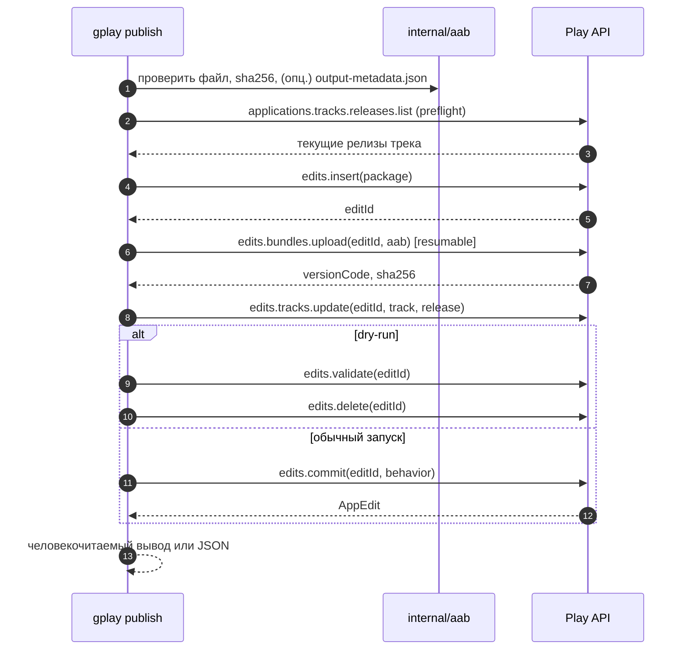

# 02 — Архитектура

## 1. Принципы

1. **Stateless.** Никакой локальной БД, кэша и «незавершённых транзакций». Состояние живёт в Play; локально —
   только артефакт и параметры запуска.
2. **Один запуск — один edit.** Это минимизирует расход суточной квоты и площадь конфликтов.
3. **Fail fast.** Ошибки авторизации, прав, отсутствия приложения и конфликтов состояния не ретраятся.
4. **Обратимость известна.** До `commit` всё можно удалить; после — только новый релиз или halt.
5. **Безопасные дефолты.** Не отменять чужое ревью; не публиковать в production без явного флага; не удалять
   историю трека.
6. **Машиночитаемость.** Каждый результат имеет код выхода и JSON-представление для CI.

## 2. Структура пакетов

```
cmd/gplay/                 main: сборка App, вызов cli.ExecuteContext, os.Exit(code)
internal/cli/              cobra: root + команды (тонкий слой, по файлу на команду)
  root.go                  PersistentFlags, группы, Execute
  publish.go               флаги → app.Publish
  doctor.go                флаги → app.Doctor
  status.go                флаги → app.Status
internal/app/              use-case'ы без cobra и без androidpublisher
internal/play/             тонкая обёртка над androidpublisher: интерфейс + реализация + маппинг ошибок
internal/artifact/         инспекция артефакта: ZIP-сигнатура, output-metadata.json, sha256
internal/release/          домен: ReleasePlan, валидация статуса/дроби/notes, имена треков
internal/retry/            backoff-политика и классификация ошибок
internal/logging/          slog, debugTransport, редактирование секретов
internal/exitcode/         типы ошибок → коды выхода
internal/version/          версия, commit, дата сборки
```

Почему так:

- `cli` не знает про `androidpublisher` — только про use-case'ы `app` и интерфейс `play.API`;
- `app` не знает про `cobra` — оркестрация шагов публикации, легко тестируется;
- `release` не знает про HTTP — чистая валидация, легко тестируется таблицами;
- `play` — единственное место, где живут типы Google-клиента, чтобы обновление клиента не расползалось по коду.

Стек и соглашения по cobra — в [06-stack.md](06-stack.md), решение — в
[ADR-0003](adr/0003-cobra-command-layout.md).

## 3. Границы и интерфейс

```go
// internal/play
type API interface {
    CreateEdit(ctx context.Context, pkg string) (editID string, err error)
    UploadBundle(ctx context.Context, pkg, editID string, r io.Reader, size int64) (BundleInfo, error)
    UpdateTrack(ctx context.Context, pkg, editID, track string, rel Release) error
    ValidateEdit(ctx context.Context, pkg, editID string) error
    CommitEdit(ctx context.Context, pkg, editID string, opts CommitOptions) error
    DeleteEdit(ctx context.Context, pkg, editID string) error
    TrackReleases(ctx context.Context, pkg, track string) ([]ReleaseSummary, error) // read-only
}
```

`CommitOptions{ChangesNotSentForReview bool, InReviewBehavior InReviewBehavior}`.
`BundleInfo{VersionCode int64, SHA256, SHA1 string}` — ровно то, что нужно для лога и JSON.

Реализация — `play.Client` с `*androidpublisher.Service`: сервис создаётся с `option.WithHTTPClient`
(oauth2-клиент из ADC или `--credentials`) и `option.WithEndpoint` для тестов; User-Agent ставится в transport,
таймаут задаётся контекстом операции.

## 4. Поток `publish`



### Preflight (до создания edit)

- файл существует, читается, не пуст, является ZIP и содержит `BundleConfig.pb` (признак AAB, а не APK);
- если передан `--metadata output-metadata.json` — `applicationId` совпадает с `--package`, а `versionCode`
  известен заранее (в API его передавать не нужно: Play вернёт его после загрузки; значение нужно для логов
  и preflight-сверки);
- `--package` синтаксически валиден (сегменты через точку);
- трек существует в списке треков (или разрешено создание кастомного closed-трека — вне MVP);
- если `versionCode` известен и уже присутствует в целевом треке → поведение по `--if-exists` (`fail` по умолчанию);
- статус/дробь согласованы: `inProgress` требует `0 < rollout < 1`, `completed` — без дроби.

Preflight намеренно дешёвый и не создаёт edit: суточная квота на создание edits расходуется только когда
всё остальное проверено.

### Загрузка

- `Media` с `googleapi.ChunkSize(8 MiB)` и `googleapi.ChunkRetryDeadline(30 s)`: файлы меньше чанка клиент
  отправляет multipart-запросом, большие — resumable-чанками;
- прогресс — `ProgressUpdater`, `INFO` каждые 5 % (в debug — подробнее), чтобы CI не выглядел зависшим;
- после ответа — сверить `sha256` с локальным и залогировать `versionCode`.

### Обновление трека

MVP отправляет **один релиз** в `tracks.update` (как в примере Google). Это декларативная замена ресурса:
инструмент не пытается «дописать» релиз к истории. Если интеграционный тест покажет, что нужен merge
(сохранение предыдущих `completed`-релизов), добавляется режим `tracks.get → merge → update` без изменения CLI.

### Коммит

- `InReviewBehavior`: по умолчанию `ERROR_IF_IN_REVIEW`; `CANCEL_IN_REVIEW_AND_SUBMIT` — только явным
  `--on-in-review=replace`.
- `ChangesNotSentForReview`: по умолчанию `false`; при отказе Play «нельзя отправить автоматически» —
  ровно одна повторная попытка с `true` и код выхода «требуется ручное действие».

## 5. Политика ревью

| Ситуация | Поведение |
| --- | --- |
| На ревью ничего нет | Обычный коммит, изменения уходят на ревью |
| Что-то на ревью, `--on-in-review=error` (дефолт) | Ошибка до отправки, код 5, понятное сообщение; чужое ревью не отменяется |
| Что-то на ревью, `--on-in-review=replace` | Коммит с `CANCEL_IN_REVIEW_AND_SUBMIT`; в лог — предупреждение, что предыдущее ревью отменено |
| Play требует ручной отправки | Повтор с `changesNotSentForReview=true`, код 8, инструкция «отправить из консоли» |
| Managed publishing | Только для closed/open/production: коммит успешен, но публикация ждёт ручного шага; для `internal` не наступает |

Для `internal` ревью обычно нет: сборка становится доступна сразу. Исключения — первый роллаут приложения и
ситуация, когда предыдущая отправка была отклонена; тогда `commit` уходит на ревью, и это нормальный сценарий,
а не ошибка инструмента.

## 6. Идемпотентность и восстановление

Естественный ключ публикации — `versionCode`. Он уникален в рамках приложения и не может быть переиспользован
для нового релиза.

| Сбой | Состояние | Действие |
| --- | --- | --- |
| Ошибка до `edits.insert` | Ничего не создано | Выход с кодом причины, без ретраев |
| Ошибка `bundles.upload` (сеть/5xx) | Edit активен | Ретрай чанков; при смерти сессии — повторная загрузка в тот же edit |
| Ошибка `tracks.update` (валидация) | Edit активен, AAB загружен | Не ретраить; удалить edit (best effort), код 7, сообщение Play |
| Ошибка `commit` (валидация) | Edit активен | Удалить edit, код 7; правки — в параметрах запуска/сборке |
| Таймаут/5xx на `commit` (неоднозначно) | Неизвестно | Проверить `applications.tracks.releases.list`: если `versionCode` в треке — успех; иначе повторить commit (edit ещё жив) |
| `edit not found` / `edit invalid` на commit | Edit инвалидирован | Проверить трек; если версии нет — код 5 с инструкцией перезапустить с новым versionCode |
| `versionCode` уже в треке | Релиз уже есть | `--if-exists=skip` → успех (идемпотентный повтор); иначе код 5 |
| SIGINT/SIGTERM | Edit активен | Отменить контекст, best-effort `edits.delete` в отдельном коротком контексте, код 130 |

Повторная публикация того же AAB после **успешного** commit не выполняется: это отдельный релиз с тем же
versionCode, который Play отклонит. Если `versionCode` известен из метаданных, инструмент распознаёт это до
загрузки; если нет — по ответу Play и коду выхода 5.

## 7. Таймауты и отмена

| Параметр | Значение по умолчанию | Комментарий |
| --- | --- | --- |
| Общий дедлайн | 20 min | `--timeout`; покрывает загрузку и коммит |
| HTTP-таймаут запроса | 5 min | Для `bundles.upload` — не меньше 2 min (рекомендация Google) |
| Ретраи | до 5 попыток, экспоненциально | Только 5xx/429/сетевые; см. [05](05-errors.md) |
| Дедлайн ретрая чанка | 30 s | `ChunkRetryDeadline` |

Отмена по сигналу: `signal.NotifyContext`, отдельный `context.WithTimeout(..., 15*time.Second)` для очистки,
чтобы не «повиснуть» на удалении edit.

## 8. Логирование и debug-режим

- `log/slog`; уровень `INFO` по умолчанию, `--debug` (или `GPLAY_DEBUG=1`) переключает на `DEBUG`.
- Всё пишется в `stderr`; `stdout` — только результат. При `--json` в `stdout` ровно один объект.
- Формат: `text` для человека, `json` для CI (`--log-format=json`); цвет только при TTY и без `NO_COLOR`.
- Обязательные поля: `time`, `level`, `phase` (`preflight|insert|upload|track|commit|cleanup`), `package`,
  `track`, `version_code`, `edit_id`, `duration_ms`, `attempt`.
- Debug добавляет: HTTP-обмен (метод, URL, статус, длительность, размер, попытка), тела запросов/ответов
  до 4 KiB, correlation id из заголовков ответа, решения о ретраях и backoff, источник каждого параметра
  (флаг/env/дефолт), стектрейсы для `INTERNAL`.
- Реализация: обёртка `http.RoundTripper` (`debugTransport`). Для обычных JSON-запросов тело буферизуется и
  восстанавливается; для `bundles.upload` тело не читается — логируются только заголовки
  (`Content-Range`, `Content-Length`) и прогресс, чтобы не ломать resumable-загрузку и не удваивать память.
- Прогресс загрузки: `INFO` раз в 5%, `DEBUG` раз в секунду (байты, процент, текущий чанк).
- Редактирование: никогда не логируются `Authorization`, OAuth-токены, `private_key` и содержимое ключа,
  байты AAB; путь к ключу логировать допустимо. Тела ошибок обрезаются, бинарные тела не дампятся.
- Debug не меняет поведение, таймауты и ретраи; накладные расходы — только на логирование.
- Тест: golden-тест debug-лога, проверяющий отсутствие `private_key`, `Authorization` и значений токенов.
- Итоговый JSON (`--json`) — стабильная схема, см. [03-cli-contract.md](03-cli-contract.md#7-debug-режим).

## 9. Безопасность

- Аутентификация — ADC. Инструмент получает только путь к JSON-ключу service account: через
  `GOOGLE_APPLICATION_CREDENTIALS` или флаг `--credentials`; всё остальное о ключе он не знает.
- Least privilege: service account — отдельный, только на нужные приложения, только права на релизы
  (см. [04](04-play-console-setup.md)); не Owner и не Admin аккаунта.
- Инструмент не печатает и не сохраняет AAB; работает с файлом только на чтение.
- В логах фиксируется `editId` и `versionCode` — этого достаточно для аудита вместе с Play Console.

## 10. Тестируемость

- **Юнит-тесты домена:** таблицы статусов, дробей, release notes, имён треков, кодов выхода.
- **Тесты клиента:** `httptest.Server` + `option.WithEndpoint(server.URL)` + подмена token source; проверяем
  последовательность вызовов, retry-политику, маппинг `googleapi.Error` в коды выхода.
- **Golden-тесты ошибок:** фикстуры реальных ответов Play (400/403/404/409) → ожидаемое сообщение и код.
- **Интеграционные тесты:** отдельное тестовое приложение и внутренний трек, гейт по переменным окружения
  (`GPLAY_INTEGRATION=1`), уникальный versionCode на прогон, очистка edit в `t.Cleanup`.
- **Контрактный тест:** раз в релиз — прогон на реальном приложении; ловит изменения API и клиента.

## 11. Что осознанно не делается

- параллельные публикации и очередь;
- локальный журнал транзакций и «докат» после падения процесса;
- ожидание завершения ревью/публикации (нет API-статуса ревью; публикация занимает часы);
- управление listing, тестерами, ценами, продуктами;
- подпись и сборка AAB;
- создание приложения и первая публикация.
